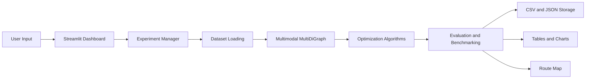

# Project Journey

## 1. Project Introduction

This project investigates route optimization in a directed multimodal
transportation network. A traveler may move between Indian cities using road,
rail, air or waterways connections, and each connection has different cost,
travel-time and carbon-emissions characteristics.

The application optimizes three objectives independently:

- **Cost**
- **Travel time**
- **Carbon emissions**

The objectives are not combined into one weighted score. A user selects the
objective of interest, and each algorithm searches for a route that minimizes
that objective. The current repository implements classical algorithms only.
Quantum and hybrid optimization remain future work.

## 2. Project Journey: From Idea to Application

The project began with the need to compare route-optimization approaches on a
network where transport modes can coexist between the same cities. The design
progressed through seven phases:

1. Deterministic datasets were created with reference coordinates and clearly
   labelled simulated transport attributes.
2. The datasets were converted into validated NetworkX `MultiDiGraph`
   objects, preserving parallel edges and connection identities.
3. Five algorithms were placed behind a common result interface.
4. Routes were independently validated and benchmarked.
5. A user-controlled manager orchestrated only selected experiments and
   persisted their results.
6. Streamlit exposed the workflow through an interactive dashboard.
7. Integration tests, documentation and visual route analysis completed the
   classical application.

Subsequent improvements added city-name selectors, parameter guidance,
comparison-graph popovers, an interactive schematic route map, and
human-readable experiment names while preserving unique persistence IDs.
The evaluation dashboard now also provides measured-repetition error bars,
reference optimality-gap comparisons, safe logarithmic memory visualization,
algorithm-specific convergence labels, and a comparable cross-dataset
scalability view.
The route view additionally summarizes all metrics from the selected exact
edges, provides an ordered connection timeline and mode statistics, and
switches among saved algorithm routes without re-execution.

## 3. Seven Implementation Phases

### Phase 1: Project Setup and Dataset Preparation

**Objective:** Prepare six deterministic transportation datasets containing 10,
20, 30, 40, 50 and 60 cities.

**Why it was necessary:** Algorithms and benchmarks require a known, repeatable
network with a documented schema and data provenance.

**Implemented work:**

- `backend/data/prepare_datasets.py` defines 60 Indian city references,
  coordinates, connection generation and the supported dataset sizes.
- `backend/data/inspect_datasets.py` reports city counts, directed edges,
  modes, waterway edges and connectivity.
- `datasets/raw/` contains the master city and connection files.
- `datasets/processed/` contains generated CSV and metadata files.
- Coordinates are labelled `manually_curated_reference`.
- Transport connections and numeric attributes are labelled
  `simulated_for_development`.
- Waterways are limited to explicitly documented corridors.

**Validation:** `tests/test_phase1_datasets.py` checks all dataset sizes,
schemas, positive attributes, waterway policy and metadata provenance.

**Outcome:** Six reproducible processed datasets are available.

### Phase 2: Multimodal Graph Construction

**Objective:** Convert dataset rows into validated multimodal graphs.

**Why it was necessary:** Algorithms need a graph abstraction that supports
directed travel and multiple transport choices between one city pair.

**Implemented work in `backend/graph.py`:**

- City IDs become graph node keys.
- Connection IDs become `MultiDiGraph` edge keys.
- Edges store mode, distance, cost, travel time, emissions and provenance.
- Required fields, numeric values, duplicate IDs, endpoints and self-loops are
  validated.
- Connectivity and parallel-mode reporting helpers are provided.

For example, `C01 -> C02` can have separate road, rail and air edges. Each
edge is distinct and can be retrieved with its connection ID.

**Validation:** `tests/test_phase2_graph.py` verifies graph type, edge identity,
parallel modes, connectivity and invalid input handling.

**Outcome:** The graph layer preserves enough information to validate and
visualize the exact selected transport edge.

### Phase 3: Classical Optimization Algorithms

**Objective:** Implement five algorithms behind one optimization interface.

**Implemented modules:** `backend/algorithms/common.py`,
`dijkstra.py`, `astar.py`, `nsga2.py`, `simulated_annealing.py` and
`ant_colony.py`.

- **Dijkstra:** objective-weighted shortest-path search.
- **A* Search:** objective-weighted search with a coordinate-based heuristic.
- **NSGA-II:** `pymoo` discrete waypoint optimization.
- **Simulated Annealing:** stochastic waypoint search with temperature cooling.
- **Ant Colony Optimization:** seeded edge-pheromone search with visited-city
  constraints and heuristic route construction.

Every algorithm returns `OptimizationResult`, containing ordered nodes, exact
edge IDs, modes, objective value, feasibility and metadata. Dijkstra and A*
are deterministic shortest-path approaches. NSGA-II and Simulated Annealing
are iterative and use stochastic search settings. ACO uses seeded ant
construction, pheromone evaporation and route deposits.

NSGA-II is used as a single-objective run for the selected objective. It does
not combine cost, time and emissions into a multi-objective score.

**Validation:** `tests/test_phase3_algorithms.py` checks all algorithms and
objectives, route shape, reproducibility for seeded stochastic runs and
invalid inputs.

**Outcome:** Five classical optimizers share a consistent, edge-preserving
result contract.

### Phase 4: Evaluation and Benchmarking

**Objective:** Compare algorithms using common validation and measurements.

**Implemented in `backend/evaluation.py`:**

- One unrecorded warm-up execution per algorithm and combination.
- Configurable measured repetitions.
- Route validity and exact edge-identity validation.
- Recalculated cost, time and emissions.
- Execution time and peak `tracemalloc` memory.
- Objective-optimal reference route and optimality gap.
- Mean, median and population standard deviation.
- Function-evaluation counts and convergence histories where available.

**Validation:** `tests/test_phase4_evaluation.py` checks recalculation,
repeated measurements, aggregates and warm-up exclusion.

**Outcome:** Results can be compared using both solution quality and resource
requirements without treating one runtime measurement as universal.

### Phase 5: User-Controlled Experiment Manager and Results Storage

**Objective:** Execute only the dataset-objective combinations explicitly
selected by the user and persist their results.

**Implemented in `backend/experiment_manager.py`:**

- `ExperimentConfig` stores selected datasets, objectives, endpoints and
  repetitions.
- `ExperimentManager` validates selections and orchestrates benchmark calls.
- Results are saved as CSV and JSON under `experiments/results/`.
- Route nodes, exact edge IDs and modes remain in persisted records.
- `experiment_id` remains a unique timestamp/UUID persistence identity.
- `experiment_name` is a separate human-readable display label such as
  `Exp_D10_AHM_AMR`.
- Duplicate display names receive a timestamp and short UUID suffix.
- Legacy JSON records without `experiment_name` retain their IDs and receive a
  computed history-label fallback.

**Validation:** `tests/test_phase5_experiment_manager.py` checks selection
scoping, persistence and invalid inputs. `tests/test_experiment_naming.py`
checks dataset-derived names, duplicate identity and persisted metadata.

**Outcome:** Experiments are reproducible, separately retrievable and easier
to recognize in the dashboard history.

### Phase 6: Frontend and Interactive Dashboard Development

**Objective:** Provide a usable Streamlit interface around the backend.

**Implemented in `app/main.py`:**

- Dataset and independent-objective multi-selectors.
- City-name source and destination selectors that retain city IDs internally.
- Number inputs for repetitions, NSGA-II population and generations, and
  Simulated Annealing iterations.
- Native parameter information tooltips with recommendations and trade-offs.
- Explicit **Run Experiment** execution.
- Progress status, route tables, comparison charts, downloads and history.
- Comparison-chart popovers for objective quality, resource usage and
  convergence.
- History labels based on `experiment_name` with legacy fallback support.

**Route map:** `app/components/route_map.py` uses Folium,
Streamlit-Folium and OpenStreetMap tiles. It renders one selected algorithm
route using exact stored edge IDs. Source, destination and intermediate city
markers, edge popups, bounds fitting and mode styles are included.

Road is blue solid, rail red dashed, air purple dotted and waterways green
dash-dot. The map is schematic city-to-city geometry, not actual transport
infrastructure.

**Validation:** Browser checks confirmed dashboard startup, controls, chart
popovers and route-map rendering. `tests/test_route_map.py` checks route order,
coordinates, exact parallel-edge selection, styles, labels and invalid data.

**Outcome:** The dashboard supports end-to-end configuration, execution,
comparison, persistence and route visualization.

### Phase 7: Integration, Testing and Finalization

**Objective:** Make the classical application reliable and demonstrable.

**Implemented work:**

- Integration coverage spans six datasets, three objectives and four
  algorithms.
- Invalid endpoints, disconnected routes and invalid selections are tested.
- Documentation covers implementation, data provenance, usage and limitations.
- `manual_phase7_checkpoint.py` runs lightweight integrations across all
  supported datasets.

**Validation:** The automated suite currently contains 109 tests, including
  dataset, graph, algorithm, evaluation, experiment-manager, integration and
  route-map tests. Runtime checkpoint and Streamlit health checks have also
  been performed.

**Outcome:** The classical application is integrated and documented. Quantum
and hybrid optimization remain outside the implemented scope.

## 4. Understanding the Project Architecture



The frontend gathers configuration and presents results. The experiment manager
validates selections and coordinates data loading and evaluation. The graph
layer builds the `MultiDiGraph`. The algorithm layer produces standardized
routes. The evaluation layer independently validates and measures them. The
storage layer writes experiment records, while Plotly and Folium present
results.

## 5. Dataset Section

The repository includes `dataset_10`, `dataset_20`, `dataset_30`, `dataset_40`,
`dataset_50` and `dataset_60`. Each contains:

- `cities.csv` with city IDs, names, country, latitude and longitude.
- `connections.csv` with directed connection IDs, endpoints, modes, distance,
  cost, travel time and carbon emissions.
- `metadata.json` with data-source and waterway-policy labels.

City identifiers such as `C01` are stable graph keys. The dashboard displays
city names while passing the corresponding IDs to the experiment manager.
Coordinates are manually curated reference data. Numeric transport attributes
are deterministic simulated development data. Waterway edges are generated
only for documented coastal corridors.

## 6. Multimodal Graph Construction

`MultiDiGraph` is used because direction matters and parallel transport modes
must remain separate. A simplified example is:

```text
C01 (Ahmedabad)
  ├─ C01_C02_road     mode=road, cost=..., time=..., emissions=...
  ├─ C01_C02_rail     mode=rail, cost=..., time=..., emissions=...
  └─ C01_C02_air      mode=air,  cost=..., time=..., emissions=...
```

The connection ID is the edge key. Algorithms return the selected key for
every consecutive node pair, allowing validation and route-map popups to use
the exact edge rather than selecting an arbitrary parallel connection later.

## 7. Classical Optimization Algorithms

| Algorithm | Project use | Important parameters | Main limitation |
|---|---|---|---|
| Dijkstra | Weighted shortest path for selected objective | Objective | No iterative convergence history |
| A* | Weighted path with geographic heuristic | Objective | Heuristic assumptions affect search behaviour |
| NSGA-II | Discrete waypoint search with one objective | Population, generations, waypoint count, seed | More population/generations increase cost; not multi-objective here |
| Simulated Annealing | Stochastic waypoint neighbourhood search | Iterations, seed, temperature, cooling rate | Results and runtime vary with search settings |

Dijkstra and A* are deterministic shortest-path methods for a given graph and
objective. NSGA-II and Simulated Annealing iteratively explore alternatives and
can use seeded stochastic behaviour. A lower value is better for all three
supported objectives.

## 8. Experiment Setup: What Each Field Does

- **Datasets:** Selects which processed networks are loaded and executed.
- **Objectives:** Selects independent cost, time and/or emissions runs.
- **Source city:** Starting city ID, displayed by city name.
- **Destination city:** Ending city ID, displayed by city name and constrained
  to differ from the source.
- **Measured repetitions:** Number of recorded executions per algorithm.
  One is useful for functional checks; 3–5 supports preliminary comparison;
  10 is a reasonable benchmarking starting point; 20–30 provides more
  statistical stability when resources permit.
- **NSGA-II population:** Candidate-solution population. Values 10–20 are
  suitable for quick checks, 50–100 for more serious experiments, and larger
  values increase evaluation and memory cost.
- **NSGA-II generations:** Evolutionary cycles. Values 3–5 are quick checks;
  20–50 are preliminary; 100 or more supports longer searches but increases
  runtime and does not guarantee improvement.
- **Simulated Annealing iterations:** Neighbourhood-search steps. Values
  30–50 are quick checks; 100–300 are preliminary; 500–1,000 support longer
  searches; 2,000–5,000 are extensive and more expensive.

These are guidance ranges, not guaranteed optimal settings.

## 9. Understanding the Dashboard

### A. Experiment Setup

The sidebar controls datasets, objectives, repetitions and algorithm
parameters. Source and destination selectors use dataset city names but retain
the original IDs for backend execution.

### B. Experiment Execution

The user must click **Run Experiment**. The dashboard creates an
`ExperimentManager`, runs the selected combinations, displays status, stores
the result and updates the result sections.

### C. Comparisons

- **Mean Objective Value:** Compares average solution values. Since objectives
  are minimized, lower values indicate better objective results.
- **Mean Execution Time versus Peak Memory:** Shows computational resource
  requirements and helps compare speed and memory use as networks grow.
- **Best-so-far Convergence:** Shows improvement during iterative searches and
  whether progress slows or plateaus. Dijkstra and A* have no convergence
  series.

Each chart has an informational popover explaining what it shows and why it
matters.

### D. Route Visualization

After an experiment, the user selects one algorithm and clicks **View Route on
Map**. Folium renders the map through Streamlit-Folium using OpenStreetMap
tiles. Markers identify source, destination and intermediate cities. Edge
popups show available connection details such as mode, distance, cost, travel
time, emissions and connection ID.

Mode styling is road blue solid, rail red dashed, air purple dotted and
waterways green dash-dot. The lines are schematic straight city-to-city
connections based on dataset coordinates, not actual geographical transport
paths.

### E. Experiment History

Saved JSON files remain keyed by their original unique `experiment_id`, and
CSV files use the same ID as their filename. New records also contain an
`experiment_name`, for example `Exp_D10_AHM_AMR`. The name uses the selected
dataset's city count and actual source/destination city names. If a duplicate
configuration is saved, a timestamp and short unique suffix distinguish the
display names.

Older records without `experiment_name` are not rewritten or deleted. The
dashboard derives a readable fallback from their saved configuration when
possible, while preserving the original ID for retrieval.

## 10. Evaluation and Benchmarking

Each algorithm first receives one warm-up execution that is not included in
reported measurements. The configured repetitions are then measured.

Execution time is measured around the optimization call. Peak memory is
captured with `tracemalloc`. Routes are checked for matching endpoints,
matching edge and mode counts, existing exact edge IDs and valid edge
attributes.

The evaluator calculates cost, time and emissions, objective-relative
optimality gaps, mean/median/standard deviation for time and memory, function
evaluations for iterative algorithms and convergence histories where provided.
These measurements make comparisons more transparent, but runtime results
remain dependent on machine, parameters and random seeds.

## 11. Results and Interpretation

Use the objective table to compare route quality for the selected objective.
Use the resource chart to examine execution time and memory together, rather
than treating faster as automatically better. Use convergence to understand
search progress, not as a guarantee of global optimality.

No algorithm should be declared universally superior from one experiment.
Interpret results in the context of dataset size, objective, repetitions,
algorithm parameters and stochastic seeds.

## 12. Project Testing and Validation

The test suite includes:

- Dataset generation, schema and provenance tests
- Graph construction, connectivity and parallel-edge tests
- All-algorithm and objective tests
- Seed reproducibility tests
- Route validation and benchmark aggregation tests
- Experiment-manager selection and persistence tests
- Six-dataset integration tests
- Route-map preparation, styling and invalid-route tests
- Experiment-name generation and backward-compatibility tests

The current suite contains 109 tests. The dashboard has also been checked with
Python compilation, Streamlit health checks and browser interactions for
controls, charts, popovers and route maps.

## 13. Technologies Used

- **Python:** Application and algorithm implementation.
- **Streamlit:** Dashboard controls and result presentation.
- **NetworkX:** Directed multimodal `MultiDiGraph`.
- **Pandas:** Result tables and aggregation.
- **NumPy:** Numerical handling in NSGA-II.
- **pymoo:** NSGA-II engine.
- **Plotly:** Comparison and convergence charts.
- **Folium:** Interactive schematic map.
- **Streamlit-Folium:** Map embedding in Streamlit.
- **pytest:** Automated validation.

## 14. Current Project Achievements

### Implemented and tested

- Six deterministic datasets with documented provenance.
- Validated directed multimodal `MultiDiGraph` construction.
- Dijkstra, A*, NSGA-II, Simulated Annealing and ACO.
- Independent cost, time and emissions optimization.
- Exact route-edge validation and benchmarking.
- User-controlled experiment execution and CSV/JSON persistence.
- Human-readable experiment names with preserved unique IDs.
- Streamlit dashboard, comparison charts and information popovers.
- Schematic interactive route map with exact edge styling and popups.
- Automated tests and integration checkpoints.

### Implemented with stated scope

- The route map is interactive but geographically schematic.
- Transport attributes are simulated development values.
- Dashboard browser validation has been performed manually rather than through
  a dedicated automated browser test suite.

### Planned or future

- Quantum and hybrid optimization.
- Verified live or historical transport data.
- Actual geographical transport geometry.

## 15. Current Limitations

- Transport costs, times and emissions are simulated development attributes.
- Coordinates are manually curated references and should be independently
  verified before publication.
- The route map does not follow roads, railway tracks, flight paths or
  navigable waterways.
- Only six fixed dataset sizes are currently generated.
- Larger populations, generations, iterations or repetitions increase runtime
  and memory use.
- No weighted combined objective is implemented.
- No live schedules, traffic, fares or real-time emissions are used.

## 16. Future Scope

Potential extensions include:

- Real-world schedules, fares, traffic and emissions measurements.
- Actual road, rail, air and waterway geometries.
- Larger and externally validated networks.
- More advanced emissions models and sensitivity studies.
- Additional deterministic and stochastic algorithms.
- Quantum or hybrid optimization experiments.
- Automated browser regression tests and richer experiment analysis.

These possibilities are separate from the implemented classical system.

## 17. Final Project Summary

The project has developed a reproducible classical framework for studying
multimodal route optimization across six deterministic Indian-city networks.
It preserves parallel transport choices, compares five algorithms on
independent objectives, measures solution and resource behaviour, stores
results, and presents them through an interactive dashboard and schematic map.

The project is designed to investigate how algorithm choice, objective,
network size and computational settings influence route quality and resource
requirements. It provides a tested foundation for future real-world,
geographical and quantum/hybrid research without claiming those extensions
are already implemented.
