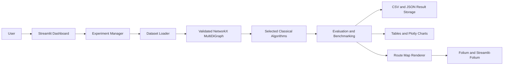

# Multimodal Transportation Route Optimization using Classical and Quantum Computing

This project explores route optimization in a directed multimodal
transportation network containing road, rail, air and waterways connections.
The implemented application is a classical optimization system: it compares
Dijkstra, A* Search, NSGA-II and Simulated Annealing while optimizing one
objective at a time:

- Minimum transportation cost
- Minimum travel time
- Minimum carbon emissions

The project title includes quantum computing because quantum and hybrid
optimization are possible future extensions. No quantum or hybrid algorithm is
implemented in the current repository.

## Project Overview

A transportation network can provide several ways to travel between two
cities. Each transport mode can have different cost, travel time and carbon
emissions. A route that is best for cost may not be best for time or
environmental impact.

The project models this problem as a NetworkX `MultiDiGraph`:

- Cities are graph nodes.
- Transportation connections are directed edges.
- Multiple edges can connect the same pair of cities, one for each available
  transport mode.
- Every edge stores distance, cost, travel time, emissions and its transport
  mode.

The Streamlit dashboard lets a user select datasets, objectives, source and
destination cities, experiment parameters and algorithm settings. It executes
the four classical algorithms, validates and benchmarks their routes, compares
the results, stores CSV/JSON output, and can display one selected algorithm's
route on an interactive schematic India map.

The city coordinates are manually curated reference data. Connection records
and their cost, travel-time and emissions attributes are deterministic
development data labelled `simulated_for_development`; they are not live
transport schedules or real-world measurements. See
[`datasets/README.md`](datasets/README.md).

## Problem Statement

The system addresses route selection in a directed multimodal network where:

1. The same city pair may have multiple transport connections.
2. Cost, time and emissions represent different optimization objectives.
3. Deterministic shortest-path methods and stochastic search methods should be
   evaluated using a consistent interface.
4. Route feasibility, solution quality and computational cost must be measured
   rather than assumed.

The objectives are optimized independently. The current implementation does
not combine cost, time and emissions into a weighted multi-objective score.

## Project Objectives

- Construct validated multimodal transportation graphs.
- Preserve parallel transport edges and their exact connection identities.
- Implement four classical route optimization algorithms.
- Compare route quality using independently selected objectives.
- Validate routes and recalculate their metrics from graph edges.
- Measure execution time and peak memory usage.
- Calculate optimality gaps against an objective-optimal reference route.
- Track convergence and function evaluations where algorithms provide them.
- Support reproducible, user-controlled experiments.
- Provide an interactive Streamlit dashboard and schematic route map.
- Leave a clear foundation for future quantum or hybrid experimentation.

## Key Features

### Multimodal Network

`backend/graph.py` loads `cities.csv` and `connections.csv` and builds a
validated NetworkX `MultiDiGraph`.

City nodes contain:

- `city_id`
- `city_name`
- Country
- Latitude and longitude
- Coordinate provenance
- Optional waterway corridor information

Connection edges contain:

- `connection_id`, used as the MultiDiGraph edge key
- Source and destination city IDs
- Transport mode
- Distance in kilometres
- Cost
- Travel time in hours
- Carbon emissions in kilograms
- Attribute provenance and waterway validation fields

Because edge keys are preserved, the selected mode and exact connection remain
available even when parallel edges connect the same cities.

### Dataset Management

The repository includes six processed datasets:

| Dataset | Cities |
|---|---:|
| `dataset_10` | 10 |
| `dataset_20` | 20 |
| `dataset_30` | 30 |
| `dataset_40` | 40 |
| `dataset_50` | 50 |
| `dataset_60` | 60 |

The source files are:

- `datasets/raw/cities_master.csv`: 60 manually curated Indian city
  coordinates.
- `datasets/raw/connections_master.csv`: deterministic master connections.
- `datasets/processed/dataset_<N>/`: generated city, connection and metadata
  files.

The deterministic generator is
[`backend/data/prepare_datasets.py`](backend/data/prepare_datasets.py).
Waterway edges are restricted to explicitly documented coastal corridors.

Regenerate and inspect datasets from the repository root:

```powershell
python -m backend.data.prepare_datasets
python -m backend.data.inspect_datasets
```

### Independent Optimization Objectives

The application supports:

- **Cost:** minimizes the edge `cost` attribute.
- **Time:** minimizes `travel_time_hours`.
- **Emissions:** minimizes `carbon_emissions_kg`.

Each selected objective is evaluated independently. Selecting multiple
objectives creates separate dataset-objective experiment combinations.

### Classical Algorithms

#### Dijkstra

Uses a weighted shortest-path search for the selected scalar objective. For a
parallel edge pair, the path calculation uses the best available edge weight,
and the final route records the exact selected edge key and mode.

#### A* Search

Uses the same objective-specific edge weighting with a geographic heuristic
based on node coordinates and conservative objective lower bounds.

#### NSGA-II

Uses `pymoo` with a discrete waypoint representation. The current application
uses NSGA-II as a single-objective optimization run for the selected objective,
not as a combined cost/time/emissions optimization.

#### Simulated Annealing

Uses route waypoint perturbations, temperature-based acceptance and cooling.
The implementation records accepted moves, function evaluations and
best-so-far convergence values.

All four algorithms return the shared `OptimizationResult` structure:

- Ordered route nodes
- Ordered exact edge IDs
- Ordered transport modes
- Objective value
- Feasibility
- Algorithm-specific metadata

### Experiment Management

[`backend/experiment_manager.py`](backend/experiment_manager.py) validates
user selections, loads only selected datasets, executes each selected
dataset-objective combination, and persists the resulting experiment.

For `d` selected datasets, `o` selected objectives and `r` measured
repetitions, the manager records `4 × d × o × r` measured algorithm
executions. Each algorithm also performs one unrecorded warm-up execution per
dataset-objective combination.

Dashboard parameters include:

- Measured repetitions
- NSGA-II population
- NSGA-II generations
- Simulated Annealing iterations

The information icons beside these controls provide recommended quick-test and
benchmarking ranges without changing the controls' defaults or limits.

### Evaluation and Benchmarking

[`backend/evaluation.py`](backend/evaluation.py) provides:

- Route endpoint, edge-count, mode and edge-identity validation
- Recalculated cost, time and emissions
- Execution time in milliseconds
- Peak memory measured with `tracemalloc`
- Objective-optimal reference solutions
- Relative optimality gaps
- Mean, median and population standard deviation for timing and memory
- Convergence histories for NSGA-II and Simulated Annealing
- Function-evaluation counts for iterative algorithms

Dijkstra and A* do not produce iterative convergence histories because they are
single-pass searches.

### Streamlit Dashboard

The dashboard in [`app/main.py`](app/main.py) provides:

- Dataset multi-selection
- Independent objective multi-selection
- City-name source and destination selectors backed by city IDs
- Experiment parameter number inputs
- An explicit **Run Experiment** button
- Progress and completion status
- Optimized route and transport-mode tables
- Plotly comparison, performance and convergence charts
- CSV result download
- Saved experiment history
- Route visualization for one selected algorithm at a time

Experiments are not executed automatically when a control changes.

### Interactive India Route Map

[`app/components/route_map.py`](app/components/route_map.py) builds a Folium
map integrated into Streamlit with `streamlit-folium` and OpenStreetMap tiles.
After an experiment completes, the user selects Dijkstra, A*, NSGA-II or
Simulated Annealing and clicks **View Route on Map**.

The map includes:

- Source, destination and intermediate city markers
- City names and IDs in marker popups
- Exact selected connection IDs and edge attributes in route popups
- Zooming and panning
- Automatic bounds fitting
- A route legend
- One selected algorithm route at a time

Transport-mode styling:

| Mode | Colour | Line pattern |
|---|---|---|
| Road | Blue | Solid |
| Rail | Red | Dashed |
| Air | Purple | Dotted |
| Waterways | Green | Dash-dot |

The map is schematic. It draws straight city-to-city lines between dataset
coordinates; it does not display actual road alignments, railway tracks,
flight paths or navigable waterway geometry.

## Technology Stack

| Technology | Purpose |
|---|---|
| Python | Core programming language |
| Streamlit | Interactive dashboard |
| NetworkX | Validated multimodal `MultiDiGraph` |
| Pandas | Result tables, aggregation and CSV handling |
| NumPy | Numerical operations used by optimization code |
| pymoo | NSGA-II implementation |
| Plotly | Dashboard charts |
| Folium | Interactive schematic geographical map |
| streamlit-folium | Folium integration with Streamlit |
| OpenStreetMap | Map tile layer |
| pytest | Automated tests |
| `tracemalloc` | Peak-memory measurement |
| CSV and JSON | Dataset and experiment persistence formats |

The dependency versions and supported ranges are defined in
[`requirements.txt`](requirements.txt).

## System Architecture



### Frontend layer

`app/main.py` collects configuration, displays controls, invokes the
experiment manager, renders results and manages the selected route-map state.

### Data and graph layer

`backend/data/` creates and inspects deterministic datasets.
`backend/graph.py` reads the CSV schema, validates fields and numeric
attributes, and constructs the `MultiDiGraph`.

### Optimization layer

`backend/algorithms/` exposes a common dispatcher and the four algorithm
implementations. `backend/algorithms/common.py` contains shared result types
and route decoding helpers.

### Evaluation layer

`backend/evaluation.py` runs warm-ups and measured executions, validates exact
edges, recalculates metrics, records measurements and builds comparison data.

### Storage and visualization layer

`backend/experiment_manager.py` stores experiment CSV and JSON files under
`experiments/results/`. Plotly renders comparison charts, while
`app/components/route_map.py` renders the interactive schematic map.

## Project Directory Structure

```text
MinorProject/
├── app/
│   ├── __init__.py
│   ├── main.py
│   └── components/
│       ├── __init__.py
│       └── route_map.py
├── backend/
│   ├── __init__.py
│   ├── graph.py
│   ├── evaluation.py
│   ├── experiment_manager.py
│   ├── algorithms/
│   │   ├── __init__.py
│   │   ├── common.py
│   │   ├── dijkstra.py
│   │   ├── astar.py
│   │   ├── nsga2.py
│   │   └── simulated_annealing.py
│   └── data/
│       ├── __init__.py
│       ├── prepare_datasets.py
│       └── inspect_datasets.py
├── datasets/
│   ├── README.md
│   ├── raw/
│   │   ├── cities_master.csv
│   │   └── connections_master.csv
│   └── processed/
│       └── dataset_<10|20|30|40|50|60>/
│           ├── cities.csv
│           ├── connections.csv
│           └── metadata.json
├── experiments/
│   └── results/
├── tests/
│   ├── test_phase1_datasets.py
│   ├── test_phase2_graph.py
│   ├── test_phase3_algorithms.py
│   ├── test_phase4_evaluation.py
│   ├── test_phase5_experiment_manager.py
│   ├── test_phase7_integration.py
│   └── test_route_map.py
├── manual_phase4_checkpoint.py
├── manual_phase5_checkpoint.py
├── manual_phase7_checkpoint.py
├── IMPLEMENTATION_PLAN.md
├── requirements.txt
└── README.md
```

Generated experiment files under `experiments/results/` are runtime artifacts
and are not part of the application source.

Important modules:

- `backend/graph.py`: CSV loading, schema checks and graph construction.
- `backend/evaluation.py`: route validation and benchmarking.
- `backend/experiment_manager.py`: selection validation, orchestration and
  persistence.
- `app/main.py`: dashboard controls and result presentation.
- `app/components/route_map.py`: route-data preparation and Folium rendering.
- `manual_phase7_checkpoint.py`: lightweight integration checkpoint across all
  datasets, objectives and algorithms.

## Installation

From the project root, create or activate a Python environment, then install
the declared dependencies:

```powershell
python -m pip install -r requirements.txt
```

The map feature requires the `folium` and `streamlit-folium` packages; both
are included in `requirements.txt`. No quantum-computing package is currently
required because no quantum implementation exists in this repository.

## Running the Dashboard

From the repository root:

```powershell
streamlit run app/main.py
```

If the environment does not automatically include the repository root on
Python's import path, use this PowerShell form:

```powershell
$env:PYTHONPATH = (Get-Location).Path
streamlit run app/main.py
```

Then:

1. Select one or more datasets.
2. Select one or more independent objectives.
3. Select source and destination cities by name.
4. Set repetitions and algorithm parameters.
5. Click **Run Experiment**.
6. Inspect tables, charts and saved-result details.
7. Select an algorithm under **Route Visualization** and click
   **View Route on Map**.

## Running Tests and Checkpoints

Run the complete automated test suite:

```powershell
python -m pytest -q
```

Run the Phase 7 integration checkpoint:

```powershell
python manual_phase7_checkpoint.py
```

The checkpoint exercises all six datasets, three objectives and four
algorithms with lightweight NSGA-II and Simulated Annealing settings. It
prints values calculated at runtime and does not create invented metrics.

Additional phase checkpoint scripts are available at the repository root:

```powershell
python manual_phase4_checkpoint.py
python manual_phase5_checkpoint.py
```

## Backend Usage

The experiment manager can be used without Streamlit:

```python
from backend.experiment_manager import ExperimentManager

result = ExperimentManager().run(
    datasets=("dataset_10",),
    objectives=("cost", "time"),
    source="C01",
    destination="C10",
    repeats=3,
)

print(result.experiment_id)
print(result.comparison)
```

Set `persist=False` for an in-memory run. Use `algorithm_kwargs` to provide
algorithm-specific settings such as NSGA-II population/generations or
Simulated Annealing iterations.

## Result Storage

Persisted experiments are written to `experiments/results/` as:

- `<experiment_id>.csv`: flat measured rows and aggregate comparison columns.
- `<experiment_id>.json`: experiment configuration, execution counts and
  serialized route records.

Records retain dataset, objective, algorithm, source, destination, route nodes,
exact edge IDs, modes, metrics, measurements and algorithm metadata.

## Data and Reproducibility Notes

- Dataset generation is deterministic.
- Stochastic algorithms receive explicit seeds during benchmarking.
- City coordinates are labelled `manually_curated_reference`.
- Transport connections and numeric transport attributes are labelled
  `simulated_for_development`.
- Waterway connections are limited to documented corridors in the generator.
- Results are runtime measurements and should not be treated as universal
  performance claims.

## Current Limitations and Future Work

The current repository intentionally focuses on classical optimization and
schematic visualization. It does not provide:

- Quantum or hybrid optimization algorithms
- Live traffic, schedules, fares or emissions data
- Real road, rail, flight or waterway geometries
- A weighted combined objective
- Simultaneous multi-algorithm route-map comparison

Potential future work includes verified real-world data, geographical route
geometry, quantum/hybrid algorithm experiments and expanded multi-objective
analysis. These are future extensions, not current implemented features.

## Related Documentation

- [`IMPLEMENTATION_PLAN.md`](IMPLEMENTATION_PLAN.md): phased implementation
  roadmap and validation criteria.
- [`datasets/README.md`](datasets/README.md): dataset generation, schema
  provenance and waterway policy.
