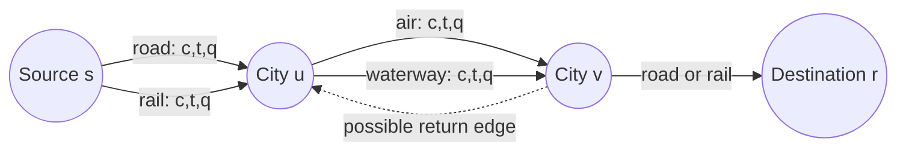

# Multimodal Transportation Route Optimization Using Classical Algorithms

## An Implemented Research-System Description

> **Document status:** Research-style technical documentation of the current
> repository implementation. Mathematical notation describes the intended
> optimization model; implementation-status tables identify where the code
> enforces or does not yet enforce each condition.

---

### Contents

[Abstract](#abstract) | [Introduction](#1-introduction) |
[Data and Network Construction](#3-data-and-network-construction) |
[Mathematical Optimization Model](#4-mathematical-optimization-model) |
[Implemented Algorithms](#6-implemented-algorithms) |
[Evaluation](#8-evaluation-and-benchmarking-methodology) |
[Testing](#11-verification-and-testing) |
[Limitations](#13-limitations-and-threats-to-validity) |
[Conclusion](#15-conclusion)

---

## Abstract

This project develops and evaluates a classical route-optimization system for directed multimodal transportation networks. Cities are represented as graph vertices and transportation connections as directed, keyed, parallel edges. Each connection carries distance, monetary cost, travel time and carbon emissions, together with its transport mode. For a selected origin, destination and scalar objective, the system compares Dijkstra's algorithm, A* search, NSGA-II, Simulated Annealing and Ant Colony Optimization. The three objectives are optimized independently: cost, travel time or emissions. The current implementation is therefore a collection of single-objective experiments, not a simultaneous multi-objective Pareto optimizer.

The system includes deterministic dataset generation, graph validation, standardized optimizer outputs, independent route validation, execution-time and memory measurements, reference shortest paths, optimality-gap analysis, experiment persistence, a Streamlit dashboard and a schematic interactive map. The repository contains six generated networks with 10, 20, 30, 40, 50 and 60 cities. Coordinates are manually curated reference data, while transportation attributes are deterministic simulated development data. This document states the mathematical model, explains the implemented algorithms and records the current limitations. The shared route construction and validation layers enforce a cycle-free final route, while all waypoint and ant candidates are required to respect visited-city constraints.

**Keywords:** multimodal transportation, directed multigraph, shortest path, A* search, NSGA-II, simulated annealing, route optimization, benchmarking

## 1. Introduction

Transportation planning between two cities may admit several connections and several transport modes. A road connection can be inexpensive but slow, rail may reduce emissions, air travel may reduce time, and waterways may have a different cost and environmental profile. Consequently, the best route depends on the selected decision criterion.

The project addresses the following computational problem:

> Given a directed multimodal transportation network, an origin city, a destination city and one scalar objective, find and evaluate a feasible route whose accumulated objective value is as small as possible.

The implemented system focuses on the classical baseline and heuristic stage of a broader project whose title also mentions quantum computing. No quantum or hybrid algorithm is implemented in the current repository. Quantum and hybrid methods are future extensions rather than results reported here.

The research system has five principal purposes:

1. Construct validated multimodal graphs while preserving parallel edges.
2. Apply deterministic and stochastic route optimizers through one interface.
3. Validate routes independently of the optimizer that produced them.
4. Compare solution quality and computational resources systematically.
5. Provide reproducible, user-controlled experiments and visual analysis.

## 2. Scope and Claims

The system supports:

- directed road, rail, air and waterway connections;
- cost, travel time and carbon emissions as independent objectives;
- one origin and one destination per optimization run;
- six deterministic processed datasets;
- five classical optimization algorithms;
- repeated experiments with seeded stochastic algorithms;
- CSV and JSON experiment persistence; and
- a Streamlit dashboard with tables, charts and route maps.

The system does **not** currently claim:

- real-time schedule optimization;
- real-world travel or emissions accuracy;
- simultaneous cost-time-emissions optimization;
- a quantum or hybrid solution;
- statistically conclusive scalability from dataset size alone; or
- a guarantee that every generated intermediate waypoint candidate is unique before decoding.

## 3. Data and Network Construction

### 3.1 Dataset structure

The raw data consists of a master city table and a master connection table. The generator creates six prefixes of the 60-city list:

$$
\mathcal{D} = \{D_{10},D_{20},D_{30},D_{40},D_{50},D_{60}\}.
$$

Each processed dataset contains `cities.csv`, `connections.csv` and `metadata.json`. A city record contains an identifier, name, country, latitude, longitude and provenance fields. A connection record contains:

$$
e = (\text{id},u,v,m,d,c,t,q),
$$

where:

- $u$ is the source city;
- $v$ is the destination city;
- $m$ is the mode;
- $d$ is distance in kilometres;
- $c$ is cost;
- $t$ is travel time in hours; and
- $q$ is carbon emissions in kilograms.

The numeric transportation attributes are labelled `simulated_for_development`. They are deterministic values for development and comparison, not live operational measurements.

### 3.2 Haversine distance

For two cities with latitude and longitude $(\phi_1,\lambda_1)$ and $(\phi_2,\lambda_2)$ in radians, the generator computes geographic distance using the haversine equation:

$$
a = \sin^2\left(\frac{\phi_2-\phi_1}{2}\right) + \cos(\phi_1)\cos(\phi_2) \sin^2\left(\frac{\lambda_2-\lambda_1}{2}\right),
$$

$$
d = 2R\arcsin(\sqrt{a}), \qquad R=6371\text{ km}.
$$

The generated distance is rounded to two decimal places.

### 3.3 Mode-dependent attributes

For each mode $m$, the generator defines a cost factor $\alpha_m$, a speed factor $\beta_m$ and an emissions factor $\gamma_m$:

| Mode | $\alpha_m$ | $\beta_m$ | $\gamma_m$ |
|---|---:|---:|---:|
| road | 1.18 | 8.0 | 0.120 |
| rail | 0.95 | 10.0 | 0.045 |
| air | 1.65 | 2.0 | 0.255 |
| waterway | 0.60 | 16.0 | 0.030 |

For a connection of distance $d$, the implemented formulas are:

$$
c = \operatorname{round}(d\alpha_m,2),
$$

$$
t = \operatorname{round}\left(\frac{d}{10\beta_m},2\right),
$$

$$
q = \operatorname{round}(d\gamma_m,2).
$$

All four stored numeric attributes, including distance, must be strictly positive during graph construction.

### 3.4 Connection topology

For each newly considered city, the generator connects it bidirectionally to its nearest previously listed city using road, rail and air. From the third city onward, it also connects the city bidirectionally to the city two positions earlier using road and air. Waterway edges are added only for explicitly documented coastal corridors. This produces a reproducible development topology rather than a surveyed transportation network.

### 3.5 Graph model

The graph is a NetworkX `MultiDiGraph`:

$$
G=(V,E),
$$

where $V$ is the set of cities and $E$ is a multiset of directed connections. The multigraph is necessary because two cities may have multiple edges with different modes and different attributes. The connection identifier is used as the edge key, so a selected route can preserve the exact transport connection rather than only its endpoint pair.

The graph loader enforces:

- required city and edge fields;
- unique city identifiers;
- unique connection identifiers;
- valid latitude and longitude ranges;
- endpoints that exist in the city set;
- no self-loop connection where $u=v$; and
- strictly positive distance, cost, time and emissions.

These are data-integrity constraints. They do not by themselves prohibit a multi-edge route from revisiting a city.

### 3.6 Graphical model of the transportation problem

The transportation network can be viewed as a directed multigraph in which parallel edges represent alternative modes between the same cities:



Mathematically, for a city pair $(u,v)$, the parallel edge set is:

$$
E(u,v)=\{e_{uv}^{\text{road}},e_{uv}^{\text{rail}},e_{uv}^{\text{air}},e_{uv}^{\text{waterway}}\}\cap E.
$$

The intersection with $E$ is important: a mode is present only when the dataset contains that connection. A route is a directed walk through this network. The optimization layer chooses both the ordered city sequence and, for every consecutive city pair, the exact edge and therefore the transport mode.

The code-level representation is:

```text
MultiDiGraph
  node: city_id -> city attributes and coordinates
  edge: (source_city_id, destination_city_id, connection_id)
        -> mode, distance, cost, travel_time_hours, carbon_emissions_kg
```

The edge key is not cosmetic. It makes the route a sequence of exact connections rather than only a sequence of city IDs. This is necessary when, for example, both rail and air connect the same ordered pair.

## 4. Mathematical Optimization Model

### 4.1 Route representation

A route is an ordered sequence

$$
P=(v_0,e_1,v_1,e_2,\ldots,e_k,v_k),
$$

with $v_0=s$ and $v_k=r$, where $s$ is the source and $r$ is the destination. Each edge satisfies:

$$
e_i=(v_{i-1},v_i,m_i)\in E.
$$

For an objective $o\in\{c,t,q\}$, let $w_o(e)$ denote the corresponding edge attribute. The route objective is additive:

$$
F_o(P)=\sum_{i=1}^{k}w_o(e_i).
$$

The implementation maps these objectives as follows:

$$
w_c(e)=\text{cost}(e),
\quad
w_t(e)=\text{travel\_time\_hours}(e),
\quad
w_q(e)=\text{carbon\_emissions\_kg}(e).
$$

The optimization problem for one selected objective is:

$$
P_o^* \in \arg\min_{P\in\mathcal{F}(s,r)}F_o(P),
$$

where $\mathcal{F}(s,r)$ is the set of feasible source-to-destination routes.

### 4.2 Implemented feasibility conditions

The shared result and evaluation layers enforce or check the following:

$$
v_0=s,
\qquad v_k=r,
\qquad s\ne r,
$$

$$
e_i=(v_{i-1},v_i)\in E,
$$

$$
|\text{edge\_ids}|=|V(P)|-1,
\qquad
|\text{modes}|=|\text{edge\_ids}|.
$$

The validator also verifies that each returned edge key exists for the exact ordered node pair, that its stored mode agrees with the returned mode, and that all metrics can be independently recomputed from the selected edges.

### 4.3 The simple-path or cyclic constraint

If the intended transportation requirement is that a route never revisits a city, the formal constraint is:

$$
v_i\ne v_j \quad \forall i\ne j.
$$

Equivalently:

$$
|\{v_0,v_1,\ldots,v_k\}|=k+1.
$$

This constraint is enforced for final routes by both `route_from_nodes` and `validate_route`. Dijkstra and A* normally return simple shortest paths under the positive weights used here. The waypoint decoder can still encounter repeated or overlapping segment candidates, but `route_from_nodes` rejects those decoded routes and the waypoint optimizers handle them as infeasible candidates.

This is an important distinction between:

1. **Algorithmic behavior:** the standard shortest-path routines generally avoid cycles under positive weights; and
2. **System-level feasibility:** the shared route contract rejects a repeated city before the route is returned or benchmarked.

Unique waypoint genes are now enforced during candidate generation and NSGA-II evaluation. The decoder also rejects any duplicate waypoint sequence, while the shared route constructor rejects overlap introduced by concatenated shortest-path segments.

## 5. Objective Handling and Parallel Edges

For a fixed ordered node pair $(u,v)$, multiple edges may exist. The path search weight used by Dijkstra, A* and waypoint segment decoding is:

$$
\widetilde{w}_o(u,v)=\min_{e\in E(u,v)}w_o(e),
$$

where $E(u,v)$ is the set of parallel connections from $u$ to $v$.

After a node sequence has been selected, `route_from_nodes` resolves the exact edge using the same objective and stores its key and mode. Consequently, route metrics are computed from the actual selected edge rather than from an unidentified endpoint pair.

The objectives are intentionally separate. Selecting cost, time and emissions creates three independent optimization runs:

$$
\min F_c(P),\qquad \min F_t(P),\qquad \min F_q(P).
$$

The current system does not solve:

$$
\min \left(\lambda_cF_c(P)+\lambda_tF_t(P)+\lambda_qF_q(P)\right),
$$

nor does it construct a Pareto front across the three metrics.

### 5.1 Complete mathematical route formulation

The route problem can be written as a binary network-flow model for one selected objective $o$. Let $x_e\in\{0,1\}$ indicate whether edge $e$ is selected. Let $\delta^+(v)$ and $\delta^-(v)$ denote the outgoing and incoming edge sets of city $v$. The objective is:

$$
\min_{x}\quad \sum_{e\in E}w_o(e)x_e.
$$

The source-destination flow constraints are:

$$
\sum_{e\in\delta^+(v)}x_e-
\sum_{e\in\delta^-(v)}x_e=
\begin{cases}
1,&v=s,\\
-1,&v=r,\\
0,&v\in V\setminus\{s,r\}.
\end{cases}
$$

They express one unit of flow from source to destination. The edge-domain constraint is:

$$
x_e\in\{0,1\}\qquad\forall e\in E.
$$

The implementation does not solve this binary program directly. Instead, Dijkstra and A* solve the equivalent positive-weight shortest-path problem, while NSGA-II and Simulated Annealing search waypoint encodings and ACO constructs edge-level ant routes with pheromone guidance.

If the intended solution must be a simple path rather than merely a feasible flow, the mathematical model additionally requires:

$$
\sum_{e\in\delta^-(v)}x_e\le 1
\qquad\forall v\in V,
$$

and the route sequence must satisfy:

$$
v_i\ne v_j\qquad\forall i\ne j.
$$

The binary flow constraints alone can admit disconnected positive-flow cycles unless an explicit cycle-elimination condition is included. This is why the sequence-level uniqueness condition is the clearest contract for this project.

### 5.2 Mathematical model versus implemented code

The following table states the constraint in mathematical form, the relevant implementation location and the current status.

| Constraint | Mathematical form | Code location | Status |
|---|---|---|---|
| Valid source | $s\in V$ | `ensure_endpoints` in `backend/algorithms/common.py` | Enforced |
| Valid destination | $r\in V$ | `ensure_endpoints` in `backend/algorithms/common.py` | Enforced |
| Different endpoints | $s\ne r$ | `ensure_endpoints` and experiment configuration validation | Enforced |
| Directed adjacency | $(v_{i-1},v_i)\in E$ | `best_edge` and `validate_route` | Enforced |
| Exact connection identity | $e_i$ exists for the ordered pair | `validate_route` and route-map preparation | Enforced |
| Mode consistency | $m_i=\operatorname{mode}(e_i)$ | `validate_route` | Enforced |
| Edge/node sequence length | $|E'|=|V|-1$ | `validate_route` | Enforced |
| Mode/edge sequence length | $|M|=|E'|$ | `validate_route` | Enforced |
| Positive data attributes | $d_e,c_e,t_e,q_e>0$ | `_numeric_attributes` in `backend/graph.py` | Enforced at graph load |
| No self-loop input edge | $u\ne v$ for every input edge | `build_graph` in `backend/graph.py` | Enforced at graph load |
| Feasible waypoint segment | a directed path exists between consecutive genes | `route_from_waypoints` | Penalized during NSGA-II; skipped during SA |
| Unique waypoint genes | $x_i\ne x_j$ for $i\ne j$ | NSGA-II `_WaypointProblem`, SA neighbor generation | Enforced |
| No overlapping decoded segments | $V(P)$ contains no repeated city | `route_from_waypoints` via `route_from_nodes` | Rejected |
| Cycle-free final route | $v_i\ne v_j$ for $i\ne j$ | `route_from_nodes`, `validate_route` | Enforced |
| Objective validity | $o\in\{c,t,q\}$ | `validate_objective` | Enforced |
| Positive iteration parameters | $K\ge1$, $N\ge2$, $G\ge1$ | algorithm parameter checks | Enforced |

This distinction should be preserved in any formal report: some constraints are properties of input data, some are enforced while constructing a candidate, and some are only checked after an optimizer returns. The no-cycle constraint is now part of the shared code contract for both constructed and externally validated routes.

### 5.3 Constraint handling in candidate evaluation

For NSGA-II, a chromosome $x$ is decoded and evaluated as:

$$
\widehat{F}_o(x)=
\begin{cases}
F_o(\operatorname{decode}(x)),&\operatorname{decode}(x)\text{ is connected},\\
10^{15},&\text{otherwise}.
\end{cases}
$$

This is a penalty for missing path segments and for decoded routes rejected by the shared simple-path check. Duplicate genes are assigned an explicit inequality violation in NSGA-II, while Simulated Annealing excludes occupied waypoints when generating a replacement.

For Simulated Annealing, a candidate is accepted according to its objective change when it can be decoded. A missing path segment causes the candidate to be skipped while the temperature cools. Again, no explicit duplicate-node test is performed before acceptance.

The code-level predicate used by the shared route contract is:

```python
is_simple = len(route_nodes) == len(set(route_nodes))
```

The route constructor raises an infeasibility exception when `is_simple` is false, and the validator records `route revisits a city` for externally supplied invalid results. This keeps the check before benchmarking, persistence and dashboard rendering.

## 6. Implemented Algorithms

### 6.1 Dijkstra's algorithm

Dijkstra's algorithm maintains a tentative distance $D(v)$ from the source. Initially:

$$
D(s)=0,\qquad D(v)=+\infty\quad(v\ne s).
$$

For an extracted node $u$ and a neighbor $v$, relaxation is:

$$
D(v)\leftarrow\min\left(D(v),D(u)+\widetilde{w}_o(u,v)\right).
$$

The predecessor relation reconstructs a minimum-weight node path. Because all generated objective attributes are positive, the optimization does not benefit from traversing a positive-cost cycle.

In the project, NetworkX performs the weighted search. The implementation then reconstructs exact parallel-edge identity and returns an `OptimizationResult`.

For a binary-heap implementation, the usual complexity is:

$$
O((|V|+|E|)\log |V|),
$$

although the actual runtime includes Python, NetworkX and multiedge-weight callback overhead.

### 6.2 A* search

A* ranks an open node using:

$$
f(v)=g(v)+h(v,r),
$$

where $g(v)$ is the best known cost from $s$ to $v$ and $h(v,r)$ estimates the remaining cost to destination $r$.

The project computes coordinate-space distance:

$$
\delta(v,r)=\sqrt{(\operatorname{lat}(v)-\operatorname{lat}(r))^2+ (\operatorname{lon}(v)-\operatorname{lon}(r))^2},
$$

and multiplies it by an objective-specific lower-bound constant:

$$
h_o(v,r)=\delta(v,r)\ell_o,
$$

where the implemented constants are:

$$
\ell_c=0.60,\qquad
\ell_t=\frac{1}{160},\qquad
\ell_q=0.030.
$$

The code documents this as a conservative geographic lower bound based on the generated edge model. Strict physical admissibility would require the units, coordinate geometry and lower bounds to be demonstrated for every dataset; the current latitude-longitude calculation is a development heuristic rather than a geodesically normalized proof.

### 6.3 NSGA-II in the current system

NSGA-II is traditionally a multi-objective evolutionary algorithm. In this project it is configured with:

$$
n_{\text{obj}}=1.
$$

Thus, it is used as an evolutionary single-objective waypoint optimizer, not as a three-objective NSGA-II study.

The chromosome contains $p$ integer waypoint genes:

$$
x=(x_1,x_2,\ldots,x_p),
\qquad x_j\in\{0,1,\ldots,|W|-1\},
$$

where $W$ is the set of non-endpoint graph nodes. The decoded waypoint route is:

$$
(s,W[x_1],W[x_2],\ldots,W[x_p],r).
$$

Each consecutive waypoint pair is expanded using a weighted Dijkstra segment. The scalar fitness is:

$$
f(x)=F_o(\operatorname{decode}(x)).
$$

An infeasible segment receives the penalty $10^{15}$. The configured search parameters are population size $N$, number of generations $G$, integer bounds, and a random seed. The implementation records convergence as the best objective value found in each saved generation.

The formulation includes an explicit inequality constraint preventing
$x_i=x_j$. The decoder additionally rejects overlapping shortest-path segments,
so both the chromosome and the decoded route satisfy the global simple-route
requirement.

### 6.4 Simulated Annealing

Simulated Annealing begins with a seeded random waypoint route. At iteration $k$, it proposes a neighboring route $P'$ by replacing one waypoint. Let

$$
\Delta=F_o(P')-F_o(P).
$$

If $\Delta<0$, the candidate is accepted. Otherwise it is accepted with probability:

$$
\Pr(\text{accept})=\exp\left(-\frac{\Delta}{T_k}\right).
$$

The temperature follows geometric cooling:

$$
T_{k+1}=\rho T_k,
\qquad 0<\rho<1.
$$

The default values are $T_0=100$ and $\rho=0.995$, with 500 iterations unless the caller supplies other values. The implementation records accepted moves, function evaluations and the best-so-far convergence sequence.

The initial route samples without replacement, and replacement moves exclude the other occupied waypoints. If the resulting shortest-path segments overlap, the candidate is skipped by the shared decoder.

### 6.5 Ant Colony Optimization

Ant Colony Optimization (ACO) models route construction as a cooperative
stochastic search. Each directed keyed edge $e$ has a pheromone value
$\tau_e>0$. For an ant at city $u$, let $\mathcal{A}_k(u)$ be the set of
outgoing edges whose destination has not already been visited by ant $k$.
The visited-city rule is:

$$
v\notin V_k^{\text{visited}}.
$$

This is the ACO-specific cycle constraint. An ant is not permitted to traverse
an edge to a previously visited city, so every constructed ant route is a
simple path. For an eligible edge $e=(u,v)$, the objective-specific heuristic
desirability is:

$$
\eta_e=\frac{1}{w_o(e)}.
$$

The probability of selecting edge $e$ is:

$$
p_e^k(u)=
\frac{\tau_e^{\alpha}\eta_e^{\beta}}
{\sum_{f\in\mathcal{A}_k(u)}\tau_f^{\alpha}\eta_f^{\beta}},
\qquad e\in\mathcal{A}_k(u),
$$

where $\alpha$ controls pheromone influence and $\beta$ controls heuristic
influence. Parallel edges remain separate choices because pheromone is keyed by
$(u,v,\text{connection_id})$.

After all ants in iteration $t$ have constructed routes, pheromone evaporates
and route deposits are applied:

$$
	au_e\leftarrow(1-\rho)\tau_e+
\sum_{k:e\in P_k}\frac{Q}{F_o(P_k)},
$$

where $\rho\in(0,1)$ is the evaporation rate and $Q>0$ is the deposit
constant. The best-so-far route is retained, and the convergence history stores
its objective value after each iteration. The implementation counts
$A\times T$ function evaluations for $A$ ants and $T$ iterations.

If an ant reaches a city with no unvisited outgoing option before reaching the
destination, that ant is discarded for the iteration. If no ant constructs a
route in the complete run, the implementation uses the objective-specific
Dijkstra route as a feasibility fallback; the result metadata records the
number of feasible ant constructions.

The ACO parameters are seed, ant count $A$, iteration count $T$, $\alpha$,
$\beta$, evaporation rate $\rho$ and pheromone deposit constant $Q$. The
default implementation values are $A=10$, $T=30$, $\alpha=1$, $\beta=2$,
$\rho=0.5$ and $Q=1$.

## 7. Route Decoding and Result Contract

All five algorithms return the same immutable result structure:

$$
R=(a,o,s,r,V,E',M,F,\text{feasible},I,\text{metadata}),
$$

where $a$ is the algorithm name, $o$ the objective, $s$ and $r$ the endpoints, $V$ the ordered node sequence, $E'$ the exact edge-key sequence, $M$ the mode sequence, $F$ the objective value and $I$ the iteration count.

The shared route builder performs four important tasks:

1. Select the least-weight parallel edge for each consecutive node pair.
2. Preserve exact edge identifiers.
3. Preserve the transport mode of every leg.
4. Sum the selected objective attribute.

The evaluation layer independently recomputes all supported metrics from `(source, destination, edge_id)` tuples. This prevents a reported objective value from being trusted without checking the underlying route data.

## 8. Evaluation and Benchmarking Methodology

### 8.1 Reference solution

For each dataset, endpoint pair and objective $o$, the reference route is the objective-optimal weighted shortest path:

$$
P_o^{\text{ref}}\in\arg\min_{P}F_o(P).
$$

This reference is generated using Dijkstra's shortest-path method and is used to calculate the relative optimality gap of other algorithms.

### 8.2 Optimality gap

For an algorithm value $F_o(P)$ and reference value $F_o(P_o^{\text{ref}})$, the reported gap is:

$$
\operatorname{gap}(P)=\max\left(0, \frac{F_o(P)-F_o(P_o^{\text{ref}})}{F_o(P_o^{\text{ref}})}\times100\right).
$$

If the reference is non-positive, the percentage gap is undefined. Under the positive generated attributes, this exceptional case should not occur.

### 8.3 Resource measurements

Each measured execution records:

- wall-clock execution time in milliseconds;
- peak Python-traced memory in bytes;
- route validity;
- cost, time and emissions recalculated from edges;
- objective value and optimality gap;
- node-exploration information where available;
- function-evaluation count for iterative methods; and
- convergence history for NSGA-II, Simulated Annealing and ACO.

One warm-up execution is performed per algorithm and dataset-objective pair, but is excluded from reported measurements. Repeated measured executions are numbered from 1. Stochastic algorithms receive deterministic seeds by run when the caller does not provide one.

### 8.4 Summary statistics

For measured values $z_1,\ldots,z_n$, the system reports arithmetic mean:

$$
\bar z=\frac{1}{n}\sum_{i=1}^{n}z_i,
$$

median, and population standard deviation:

$$
\sigma=\sqrt{\frac{1}{n}\sum_{i=1}^{n}(z_i-\bar z)^2}.
$$

These statistics are applied to execution time and memory summaries grouped by dataset, algorithm and objective. They describe the recorded development experiments; they are not a substitute for a broader statistical study.

### 8.5 Experiment count

For $d$ selected datasets, $o$ selected objectives, $r$ recorded repetitions and five algorithms, the number of measured algorithm executions is:

$$
N_{\text{measured}}=5dor.
$$

The experiment manager also performs one unrecorded warm-up per algorithm for each dataset-objective combination:

$$
N_{\text{warmup}}=5do.
$$

Only explicitly selected datasets and objectives are loaded and executed.

### 8.6 Reproducible sample results

The following results were generated from the current implementation using
`dataset_10`, source `C01`, destination `C10`, one measured repetition, an
NSGA-II population of 10 for 3 generations, 30 Simulated Annealing iterations,
and 10 ACO ants for 30 ACO iterations. The benchmark performs its normal
unrecorded warm-up before these
measurements. Execution time and peak memory are implementation- and
machine-dependent; objective values and routes are the primary reproducible
outputs.

| Objective | Algorithm | Objective value | Gap (%) | Time (ms) | Peak memory (bytes) | Route |
|---|---|---:|---:|---:|---:|---|
| Cost | Dijkstra | 1449.07 | 0.00 | 0.179 | 3,296 | C01 -> C02 -> C06 -> C09 -> C10 |
| Cost | A* | 1449.07 | 0.00 | 0.157 | 1,920 | C01 -> C02 -> C06 -> C09 -> C10 |
| Cost | NSGA-II | 3373.34 | 132.79 | 42.066 | 403,705 | C01 -> C02 -> C04 -> C06 -> C09 -> C10 |
| Cost | Simulated Annealing | 1449.07 | 0.00 | 5.450 | 6,896 | C01 -> C02 -> C06 -> C09 -> C10 |
| Cost | ACO | 1449.07 | 0.00 | 25.868 | 10,216 | C01 -> C02 -> C06 -> C09 -> C10 |
| Time | Dijkstra | 15.25 | 0.00 | 0.113 | 2,528 | C01 -> C02 -> C06 -> C09 -> C10 |
| Time | A* | 15.25 | 0.00 | 0.104 | 1,896 | C01 -> C02 -> C06 -> C09 -> C10 |
| Time | NSGA-II | 35.65 | 133.77 | 27.711 | 398,963 | C01 -> C02 -> C04 -> C06 -> C09 -> C10 |
| Time | Simulated Annealing | 15.25 | 0.00 | 5.474 | 6,848 | C01 -> C02 -> C06 -> C09 -> C10 |
| Time | ACO | 15.25 | 0.00 | 26.058 | 10,197 | C01 -> C02 -> C06 -> C09 -> C10 |
| Emissions | Dijkstra | 68.64 | 0.00 | 0.128 | 2,528 | C01 -> C02 -> C06 -> C09 -> C10 |
| Emissions | A* | 68.64 | 0.00 | 0.114 | 1,896 | C01 -> C02 -> C06 -> C09 -> C10 |
| Emissions | NSGA-II | 68.64 | 0.00 | 35.307 | 406,590 | C01 -> C02 -> C06 -> C09 -> C10 |
| Emissions | Simulated Annealing | 68.64 | 0.00 | 7.903 | 9,491 | C01 -> C02 -> C06 -> C09 -> C10 |
| Emissions | ACO | 68.64 | 0.00 | 26.739 | 10,384 | C01 -> C02 -> C06 -> C09 -> C10 |

For this quick run, Dijkstra and A* agree with the objective-specific
reference for all three objectives. Simulated Annealing also reaches the
reference route under the selected seed and iteration budget. ACO also reaches
the reference for all three objectives with 10 ants and 30 iterations. NSGA-II
reaches the reference for emissions but has a positive gap for cost and time
under the small population and generation budget. These observations are
descriptive of this configuration, not general claims about algorithm
superiority.

## 9. Experiment Management and Persistence

The experiment manager validates non-empty, unique dataset and objective selections, validates the source and destination, checks positive repetition counts and verifies required dataset files. It then executes every selected dataset-objective combination through the benchmark engine.

Each experiment produces:

- an experiment identifier;
- a readable experiment name;
- a configuration record;
- measured algorithm records;
- a comparison table with grouped statistics;
- a CSV file for tabular analysis; and
- a JSON file containing configuration and serialized route data.

Route arrays such as nodes, edge IDs, modes and convergence histories are serialized explicitly so that exact results can be reconstructed later.

## 10. Application and Visualization Layer

The Streamlit dashboard exposes dataset and objective selection, source and destination selection, repetition count, NSGA-II population and generations, and Simulated Annealing iterations. Experiments run only after the explicit Run Experiment action.

The dashboard presents:

- optimized route and mode tables;
- objective comparisons;
- execution-time and memory charts;
- optimality-gap comparisons;
- convergence plots;
- aggregate statistics;
- saved experiment history; and
- CSV downloads.

The Folium route map is a schematic city-to-city view. It uses stored city coordinates and exact selected edge keys. It shows source, destination and intermediate markers, connection popups, modes and route segments. It does not draw actual road alignments, railway tracks, flight paths or navigable waterway geometries.

## 11. Verification and Testing

The repository contains tests for:

- dataset generation and data integrity;
- graph construction and parallel edges;
- all five algorithms across all three objectives;
- reproducibility of seeded stochastic algorithms;
- route validation and independent metric recalculation;
- benchmarking and warm-up exclusion;
- experiment selection and persistence;
- integration across supported datasets; and
- route-map data preparation and rendering.

The algorithm tests verify endpoint order, edge-count consistency, mode-count consistency, feasibility and positive objective values. The evaluation tests verify independently recalculated metrics, measured resource fields, convergence data and grouped statistics.

The test suite explicitly constructs a cyclic `OptimizationResult` and checks that it is rejected by both route construction and route validation. The regression case includes:

$$
P=(C01,C02,C03,C02,C10),
$$

and expects validation failure. The algorithm tests also verify that all five optimizers still return feasible routes after the simple-path constraint is enforced. Additional performance-focused tests could exercise duplicate waypoint genes and duplicate replacement moves directly.

## 12. Complexity and Interpretation

Let $n=|V|$ and $m=|E|$. A single Dijkstra or A* search is approximately $O((n+m)\log n)$ with a priority queue, subject to the multiedge weight callbacks. The actual work for waypoint algorithms is larger because each candidate route may decode several shortest-path segments.

For NSGA-II, if $N$ is population size, $G$ is generation count and $C$ is the cost of decoding and evaluating one chromosome, the dominant evaluation work is approximately:

$$
O(NGC),
$$

plus the algorithm's population-management operations.

For Simulated Annealing with $K$ iterations and candidate evaluation cost $C$, the dominant optimization work is:

$$
O(KC).
$$

For ACO with $A$ ants, $T$ iterations and route-construction cost $C_a$,
the dominant candidate-construction work is:

$$
O(ATC_a).
$$

Because each ant scans unvisited outgoing edges and can visit at most $n$
cities, $C_a$ is bounded by the graph traversal work for one simple route.

These expressions describe algorithmic scaling, not empirical runtime claims. Python interpreter overhead, NetworkX data structures, graph density, serialization and Streamlit rendering also contribute to end-to-end time.

## 13. Limitations and Threats to Validity

### 13.1 Synthetic transport attributes

Distance is based on curated city coordinates, but cost, time and emissions are generated by fixed mode factors. Results demonstrate algorithmic behavior on a controlled development benchmark and should not be interpreted as operational transport recommendations.

### 13.2 Independent objectives

Because objectives are optimized separately, the system cannot answer a true trade-off question such as how much additional cost is justified to reduce emissions. A future study should implement a vector objective and report a Pareto front or use a clearly justified scalarization.

### 13.3 Waypoint feasibility overhead

Waypoint candidates must satisfy both gene-level uniqueness and decoded-route
simple-path feasibility. NSGA-II represents duplicate genes as an inequality
constraint, while Simulated Annealing avoids occupied replacement nodes. A
candidate can still be rejected when individually shortest segment paths
overlap, so some evaluation effort may be spent on infeasible decoded routes.

### 13.4 A* heuristic assumptions

The A* heuristic uses raw latitude-longitude differences and objective-specific constants. A formal admissibility proof should account for coordinate units, longitude scale with latitude, the haversine geometry and the generated mode factors. The current implementation records the heuristic as a geographic lower-bound assumption.

### 13.5 Metaheuristic optimality

NSGA-II with one objective and Simulated Annealing are stochastic search procedures. Their output depends on seed, population, generations, iteration count, temperature and cooling rate. They do not provide the same deterministic optimality guarantee as the objective-specific Dijkstra reference.

### 13.6 Benchmark scope

The datasets contain at most 60 cities and are generated from a controlled topology. Runtime, memory and optimality results should therefore be reported as measurements for this implementation and configuration, not as universal claims about national-scale networks.

## 14. Recommended Completion for a Stronger Research Version

The next technically important improvements are to strengthen the already implemented route feasibility contract and expand the empirical evidence:

1. Add repeated-run and cross-dataset result tables to the empirical section.
2. Report confidence intervals or variability for stochastic algorithms.
3. Measure the proportion of rejected waypoint candidates.
4. Add transfer penalties, capacity or time-window constraints where data supports them.
5. Re-run every integration and benchmark checkpoint after algorithm changes.

Further research extensions include real schedule data, additional operational constraints, transfer penalties, capacity, time windows, mode-switch limits, uncertainty analysis, Pareto optimization and quantum or hybrid methods.

## 15. Conclusion

The repository implements a complete classical experimental pipeline for single-objective multimodal route optimization. Its strongest design features are the directed multigraph representation, preservation of exact parallel edge identities, common optimizer result contract, independent metric recalculation, reproducible stochastic settings, controlled experiment selection and integrated visualization.

The mathematical problem is an additive shortest-route problem over positive edge attributes, extended with waypoint-based stochastic and evolutionary search. Dijkstra supplies an objective-specific reference solution; A* adds a geographic heuristic; NSGA-II explores integer waypoint chromosomes; and Simulated Annealing explores waypoint neighborhoods with temperature-based acceptance.

The work completed is a validated classical foundation rather than a quantum optimization result or a final real-world transportation model. The global cycle-free route constraint is now implemented and tested at the shared route boundary; future work should improve candidate-generation efficiency and broaden the measured evidence.

## 16. Reproducibility Map

The main implementation surfaces are:

- `backend/data/prepare_datasets.py`: deterministic dataset generation;
- `backend/graph.py`: graph schema validation and `MultiDiGraph` construction;
- `backend/algorithms/common.py`: shared objectives, route decoding and dispatch;
- `backend/algorithms/dijkstra.py`: Dijkstra optimizer;
- `backend/algorithms/astar.py`: A* optimizer and heuristic;
- `backend/algorithms/nsga2.py`: waypoint-based NSGA-II optimizer;
- `backend/algorithms/simulated_annealing.py`: waypoint-based annealing;
- `backend/evaluation.py`: validation, references and benchmarking;
- `backend/experiment_manager.py`: experiment orchestration and persistence;
- `app/main.py`: Streamlit application;
- `app/components/route_map.py`: exact-edge schematic map;
- `tests/`: automated verification suite; and
- `manual_phase7_checkpoint.py`: lightweight cross-dataset integration run;
- `manual_results_checkpoint.py`: reproduces the sample results in Section 8.6.

Typical commands from the repository root are:

```powershell
python -m backend.data.prepare_datasets
pytest
python manual_results_checkpoint.py
streamlit run app/main.py
```
